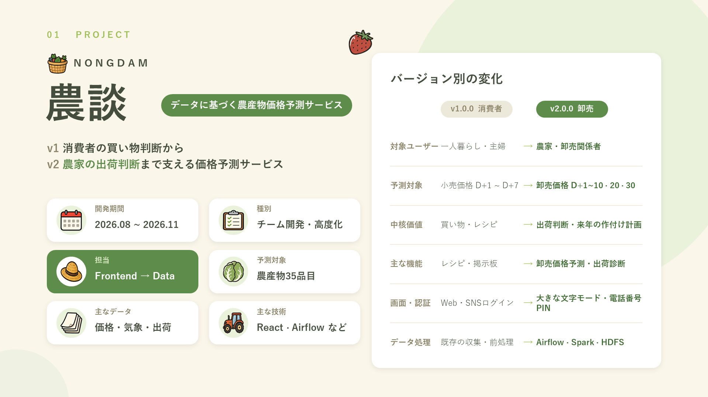
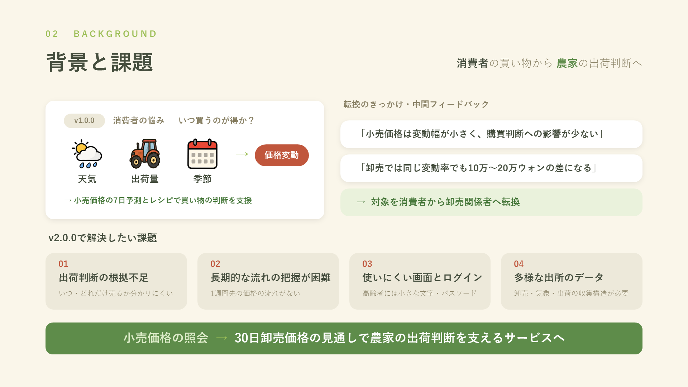
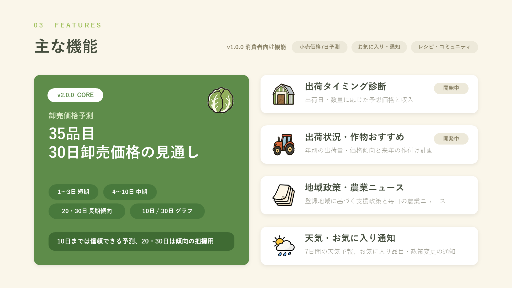
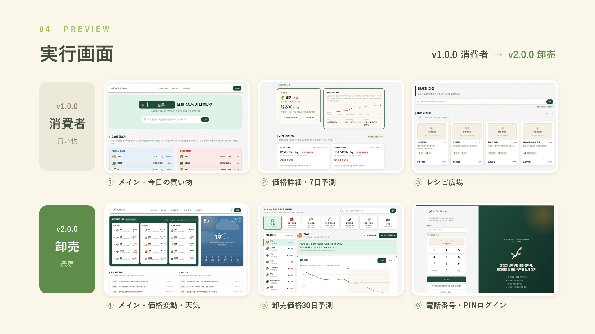
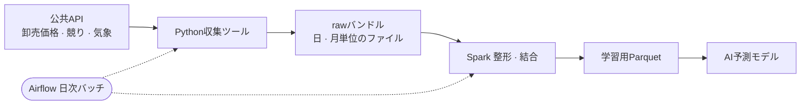

# 🌾 NONGDAM — データに基づく農産物価格予測サービス

> **v1 消費者の買い物判断**から**v2 農家の出荷判断**まで、
> 価格・気象・出荷データで農産物の将来価格を予測するサービスです。

| 項目 | 内容 |
|---|---|
| 開発期間 | 2026.08 ~ 2026.11 |
| 種別 | チーム開発 / サービス高度化 |
| 担当 | Frontend（8\~9月, v1.0.0）→ Data（10\~11月, v2.0.0） |
| 予測対象 | 農産物35品目 |
| 主な技術 | React 18 · TypeScript · Vite / Python · Airflow · Spark · Hadoop HDFS |

> 本ドキュメントは日本語話者向けのポートフォリオ資料です。アプリ自体の画面表示は韓国語のままですが、設計思想と実装内容は本ドキュメントで日本語で解説しています。

## 01. プロジェクト紹介

## 02. 背景と課題

## 03. 主な機能

## 04. 実行画面

## 05. 担当業務

### Frontend（2026.08 ~ 09）— v1.0.0 消費者向けサービス

- React 18 · TypeScriptによるメイン、価格情報、コミュニティ、マイページ画面の実装
- REST API連携による小売価格・7日予測データの表示
- 価格推移と予測結果をグラフと▲▼、一行の説明で可視化
- お気に入り農産物の登録・価格通知など消費者向けの便利機能のUI構成

### Data（2026.10 ~ 11）— v2.0.0 卸売データパイプライン

- v2卸売価格予測に必要なデータ範囲と収集期間の定義
- 気象データ担当: 観測気象（ASOS）・短期予報・中期予報の収集と前処理
- AI学習用の観測気象データを生成するSparkジョブの作成
- 過去の短期予報・競り原データをチームで分散収集するスクリプトと手順書の作成
- Airflowによる日次の収集・前処理ジョブの構成

## 06. 技術スタックと選定理由

### Frontend

| 技術 | 選定理由 |
|---|---|
| React 18 | 価格カード・グラフなど繰り返し使うUIをコンポーネントとして再利用 |
| TypeScript | 価格・予測・品目データの型を明確に管理 |
| Vite | 高速な開発サーバーと効率的なビルド |
| Tailwind CSS | デザイントークンに基づいて画面スタイルを一貫して維持 |

### Data

| 技術 | 選定理由 |
|---|---|
| Python | 公共API収集ツールと前処理スクリプトを一つの言語に統一 |
| Apache Airflow | 日次の収集・前処理ジョブのスケジュールと実行フローの管理 |
| Apache Spark | 複数ソースのデータの整形・結合とParquet生成 |
| Hadoop HDFS | 収集した原データの分散保存と管理 |

## 07. 技術実装

### 1) Frontend — 消費者向け画面の実装とAPI連携

React 18とTypeScriptで、消費者が農産物の価格を簡単に確認できる画面を作りました。

- メイン: 「今日買う？待つ？」検索と、安くなった・高くなった農産物の一覧
- 価格情報: 品目別の現在価格、前日比の変動、7日後の予想価格
- 価格詳細: 価格推移・予測グラフ、変動要因、お気に入り登録・価格通知
- APIモジュールごとにモックデータを用意し、バックエンド連携前でも画面開発とデモができる構成

数字の多い価格データを**グラフ + ▲▼ + 一行の説明**でシンプルに見せることに重点を置きました。

### 2) Data — 収集・処理パイプライン

- **収集:** aT卸売価格・競り原データ、気象庁の観測気象・短期・中期予報をソースごとの収集ツールで取得
- **保存:** raw原データは読み取り専用とし、日・月単位のファイル一つにまとめて管理
- **前処理・結合:** 欠損・重複を点検し、日付・品目・地域を基準にソースを揃えてParquetを生成
- **自動化:** Airflowで毎日の収集・前処理ジョブを実行

### 3) データ拡張と品質管理

- 予測範囲を7日からD+1\~10 · 20 · 30に広げ、過去データの収集期間を2021年からに拡大
- 主要生産地域16か所の観測気象と短期・中期予報を活用
- 同じ日付が日単位・月単位のファイル両方にある場合はジョブを失敗させ、重複反映を防止
- ジョブは再実行しても同じ結果になるようにし、テーブルごとに期間別の品質レポートを記録

## 08. トラブルシューティング

### 1) HDFSの小さなファイルの増加

**課題**
API応答を呼び出し単位で保存すると小さなファイルが増え続け、HDFS NameNodeの管理負荷が大きくなる恐れがありました。

**対応**
収集した原データを日・月単位のファイル一つにまとめる方式を適用し、何をまとめたかをmanifestに残して原データを追跡できるようにしました。

**学び**
HDFSではデータ容量だけでなく**ファイル数と保存単位**も重要で、活用目的に合わせてバッチ構造を設計する必要があることを学びました。

### 2) 気象庁APIの1日あたりの呼び出し上限による過去予報収集の中断

**課題**
AI学習用の過去の短期予報（発表日1,096日分）を収集中、気象庁APIハブの1日あたりの呼び出し上限で収集が止まりました。100日分だけで原データ約15,000件、5GB以上が必要でした。

**対応**
日付範囲をチームメンバーごとに分け、それぞれの認証キーで収集する**チーム分散収集スクリプトと手順書**を作成しました。保存した原データはハッシュで検証し、再実行時は完了済みのファイルをスキップするようにしました。

**学び**
外部APIは呼び出しの実装だけでなく**呼び出し上限・再開・重複防止**まで考慮する必要があり、複数人が実行する作業ほど手順書と検証手順が重要だと学びました。

### 3) サービス対象の転換に伴うデータの再定義

**課題**
中間フィードバックで「小売価格は変動幅が小さく、消費者の購買判断への影響が少ない」と指摘を受け、サービス対象を消費者から農家など卸売関係者へ変更することになりました。

**対応**
予測対象を小売価格から卸売価格へ、予測範囲を7日から30日へ変更するのに合わせて、収集対象・期間・テーブル構成を再定義しました。

**学び**
サービスの方向が変わるときは画面より先に**データの定義**を変える必要があり、データ範囲をドキュメントで合意しておくことがチーム作業の基準になることを学びました。

## 09. 学んだことと振り返り

### 学んだこと

- React 18 · TypeScriptによる画面開発とREST API・モックデータ連携
- 農産物の価格情報と予測結果のグラフ可視化
- Pythonによる公共APIデータ収集とAirflowによる日次バッチ構成
- Sparkによるデータ整形・結合とHDFSの保存構造
- 呼び出し上限・再開・重複防止を考慮した大量収集

### 振り返り

NONGDAMプロジェクトでは、フロントエンドとデータの両方の業務を担当し、サービスのデータの流れを最初から最後まで経験しました。

v1.0.0では消費者が農産物の価格を簡単に確認できる画面作りに集中し、v2.0.0では卸売価格の30日予測に必要なデータを収集・加工する役割を担いました。

特にサービス対象が消費者から農家へ変わる過程を経験し、**誰のためのサービスかによって必要なデータと予測範囲が変わる**ことを学びました。

画面でデータを使う立場と、パイプラインでデータを用意する立場の両方を経験し、二つの領域がどのようにかみ合うべきかを理解できました。

## 10. 出典とライセンス

### 参考資料と外部データ

- [KAMIS 農産物流通情報](https://www.kamis.or.kr/) — 農産物価格データ
- [公共データポータル](https://www.data.go.kr/) — aT卸売価格・競り原データAPI
- [気象庁APIハブ](https://apihub.kma.go.kr/) — 短期・中期予報データ
- [気象資料開放ポータル](https://data.kma.go.kr/) — 観測気象（ASOS）データ

### ライセンス

本プロジェクトは教育およびポートフォリオ目的で制作しました。

本リポジトリは**ポートフォリオの閲覧目的でのみ公開**しており、ソースコード・文書・画像の複製、改変、再配布、および他のプロジェクト・課題・商用目的での使用は許可していません。オープンソースライセンスは適用されません。詳細は [LICENSE](LICENSE) をご覧ください。
